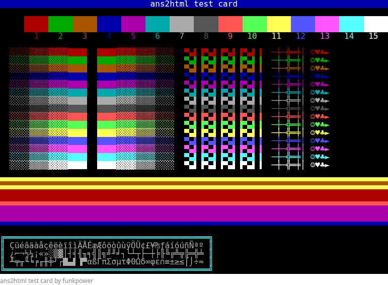

# ans2html

Draws ANSI art (`.ans`: CP437 text, ANSI.SYS escapes, a SAUCE record) as a
standalone HTML page, and plugs into Forgejo or Gitea as an external renderer,
so `.ans` files show as pictures in the repository file view instead of
mojibake.

It is one static Go binary with no dependencies, so it can be bind-mounted
into the stock Forgejo or Gitea container as it is.



## What it handles

- CP437 glyphs, including the C0 range (`☺♥♪►` and friends)
- SGR colour: the 16 VGA colours, bold as bright foreground, `38;5`/`48;5`
  256-colour, `38;2`/`48;2` and PabloDraw's `ESC[…t` 24-bit colour
- iCE colours: when the SAUCE flags ask for them (or there is no SAUCE), blink
  means bright background; otherwise blinking text blinks
- Cursor movement (`A B C D H f s u`), `2J` and `K`
- SAUCE width, so 120-column pieces don't wrap at 80, plus a caption line from
  the SAUCE title, author and group
- UTF-8 input: a file that is valid UTF-8 is read as UTF-8, anything else as CP437

Full and half blocks (`█ ▀ ▄ ▌ ▐`) are drawn with CSS backgrounds
rather than font glyphs, so they meet edge to edge in any monospace font.

## Build

```sh
CGO_ENABLED=0 go build -trimpath -ldflags='-s -w' -o ans2html .
```

The result runs on Alpine, which the Forgejo and Gitea images are built on.

## Use

```sh
ans2html piece.ans > piece.html
ans2html -w 120 < piece.ans > piece.html
```

| Flag | Default | |
|---|---|---|
| `-w N` | SAUCE width, else 80 | columns |
| `-encoding` | `auto` | `auto`, `cp437` or `utf8` |

## Forgejo / Gitea

### 1. Mount the binary

```yaml
services:
  forgejo:
    volumes:
      - ./bin/ans2html:/usr/local/bin/ans2html:ro
```

### 2. Register the renderer

In `app.ini`:

```ini
[markup.ans]
ENABLED             = true
FILE_EXTENSIONS     = .ans
RENDER_COMMAND      = /usr/local/bin/ans2html
IS_INPUT_FILE       = false
RENDER_CONTENT_MODE = iframe
NEED_POSTPROCESS    = false

[repository]
ANSI_CHARSET = IBM437
```

Or, as container environment variables (`_0X2E_` stands for the dot in the
section name):

```yaml
FORGEJO__markup_0X2E_ans__ENABLED: "true"
FORGEJO__markup_0X2E_ans__FILE_EXTENSIONS: ".ans"
FORGEJO__markup_0X2E_ans__RENDER_COMMAND: "/usr/local/bin/ans2html"
FORGEJO__markup_0X2E_ans__IS_INPUT_FILE: "false"
FORGEJO__markup_0X2E_ans__RENDER_CONTENT_MODE: "iframe"
FORGEJO__markup_0X2E_ans__NEED_POSTPROCESS: "false"
FORGEJO__repository__ANSI_CHARSET: "IBM437"
```

Use `GITEA__` instead of `FORGEJO__` on Gitea. Restart, then open any `.ans`
file.

### Why each setting

**`RENDER_CONTENT_MODE = iframe`.** The page carries its own stylesheet. In
iframe mode the output is served from a separate URL into a sandboxed iframe
(`sandbox="allow-scripts"`, no same-origin), so it keeps its styles and
nothing in it can touch the forge page or its cookies. Don't use
`no-sanitizer`: on any forge where other people can push, that lets a crafted
file run script in visitors' browsers.

**`NEED_POSTPROCESS = false`.** Post-processing turns text that looks like
issue numbers, commit hashes, mentions and `:emoji:` into links and images,
which breaks the grid.

**`ANSI_CHARSET = IBM437`.** This setting is required. Before calling a
renderer, Forgejo and Gitea convert any file that isn't valid UTF-8 to UTF-8
using a guessed charset, and CP437 art usually gets guessed as some
ISO-8859 or Windows code page, which destroys the block characters before
`ans2html` sees them. `ANSI_CHARSET` replaces that guess with a fixed label,
and since Go's charset table has no entry for IBM437, the conversion is
skipped and the original bytes come through. Other non-UTF-8 files on the
instance are affected too: their source view shows the raw bytes instead of
the guessed decoding. On a forge that is nearly all UTF-8 that is no loss.

## License

GPL-3.0-or-later. See [LICENSE](LICENSE).
